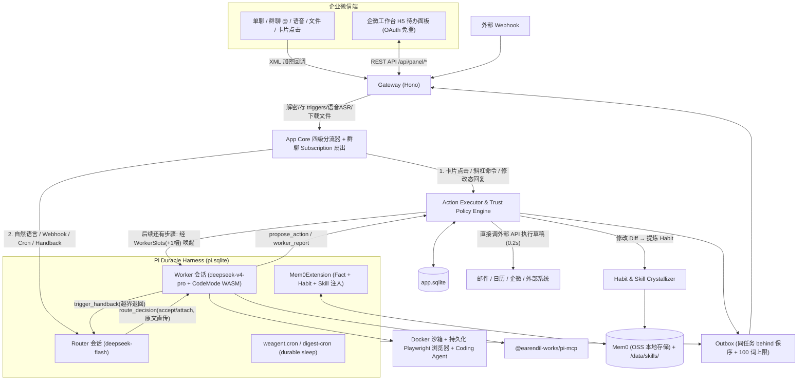
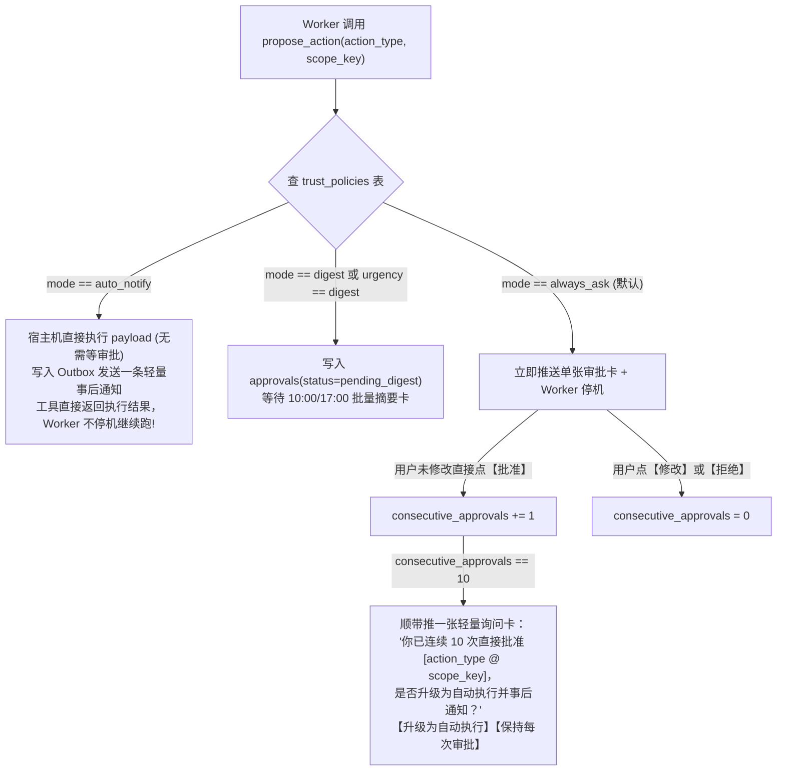
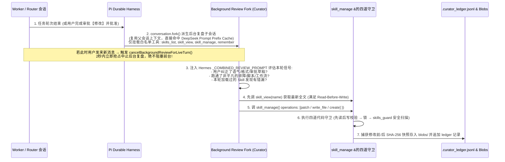

# SPEC：WeAgent v1.0 技术规格（完整版：v0.4 基座 + v1.0 六大进化）

对应 [PRD.md](file:///Users/qiu/.gemini/antigravity/brain/053524e2-0f2d-49a3-a706-15048fd3f884/PRD.md)。本文档包含：
- **第 0–11 节**：Phase 1（v0.4 核心基座：Pi Durable + 四级分流 + Router 原文直传 + Worker 五态汇报/越界退回/紧急槽位 + Draft 草稿审批 + Mem0 + Outbox 保序）；
- **第 12–17 节**：Phase 2（v1.0 六大进化能力的详细技术设计：渐进放权与批量摘要卡、Diff 习惯学习与 `SKILL.md` 沉淀、Pi Code Mode、持久化浏览器与编码子 Agent、企微语音/文件/群聊订阅扇出、企微 H5 待办中心面板）；
- **第 18–20 节**：完整的 `app.sqlite` 数据库 Schema、代码目录结构与 M0–M10 实施路线。

---

## 0. 核心引擎验证结论（已通过）

验证脚本：[examples/spike.ts](file:///Users/qiu/ai-agents-learning-hub/weagent/examples/spike.ts)（Node v24.18.0 + `@earendil-works/pi-durable@1.5.0` + SQLite）：
- **崩溃续跑**：工具执行中途进程 `exit(1)`，重启后 `harness.resume()` 自动重跑 `replay: "safe"` 工具并衔接上下文完成任务，模型不重复计费。
- **草稿停机与跨进程唤醒**：工具返回 `control: { terminate: true }` 后，Pi 立即调 `endRun()` 停止本轮；审批通过后由新进程调用 `workerConv.submit({ requestId })` 即可携带历史记录唤醒续跑，且相同 `requestId` 保证重复点击幂等。
- **并行工具停机兜底**：在 `afterTool` 钩子中统一检查会话是否有未决审批/追问/终态汇报，若有则给同轮所有工具结果补齐 `control: { terminate: true }`，满足 `generation.js:863` 的 `ordered.every(...)` 条件。

---

## 1. 总体架构图（v1.0 全景）



---

## 2. 技术选型（全栈锁定）

| 模块 | 选型 | 说明 |
|---|---|---|
| 运行时 | Node ≥ 22.19（v24.18.0），TypeScript，ESM | 原生支持 `--experimental-strip-types` 与 `node:sqlite` |
| Agent 运行时 | `@earendil-works/pi-durable@1.5.0`、`pi-ai@1.5.0`、`chord@1.5.0`、`pi-schema@1.5.0` | 锁死版本 |
| Code Mode 沙箱 | `@earendil-works/pi-durable/codemode`（`@earendil-works/pi-codemode@1.5.0`） | QuickJS WASM 沙箱内批量编排只读工具调用 |
| 图像预处理 | `@earendil-works/pi-durable/images/node`（`@silvia-odwyer/photon@0.3.3`） | Worker 线程 WASM 图像缩放、EXIF 旋转与格式转换 |
| MCP 客户端 | `@earendil-works/pi-mcp@1.5.0` | 官方同版本 MCP 客户端 |
| 长期记忆 | `mem0ai@3.3.1`（`mem0ai/oss` 本地模式） | 存用户事实（Fact）与审批中学到的习惯（Habit） |
| 语音转写 (ASR) | OpenAI 兼容 `/v1/audio/transcriptions`（硅基流动 `FunAudioLLM/SenseVoiceSmall` 或本地 Whisper）+ `ffmpeg`（AMR 转 WAV/MP3） | 处理企业微信语音条 |
| 浏览器自动化 | `playwright-core` + 持久化 User Data Dir + 可选 `noVNC` 容器 | 支持扫码登录一次、长期复用 Cookie |
| Web / 数据库 | Hono + `node:sqlite` + Kysely（WAL 模式） | |

---

## 3. 企业微信接入与全模态预处理（Phase 1 + Phase 2 M6）

### 3.1 消息验签、解密与去重
- `GET/POST /wecom/callback`：SHA1 验签 + AES-256-CBC（PKCS#7 32 字节块）解密。
- 所有入站事件先写入 `triggers` 表（以 `source_msg_id` 唯一索引去重），**5 秒内立即返回 `""`**。

### 3.2 语音、图片与文件预处理（v1.0 M6）
| 入站 `MsgType` | 预处理流水线 | 注入给 Agent 的内容 |
|---|---|---|
| `voice` | 调 `GET /cgi-bin/media/get?media_id=` 下载 `.amr` → `ffmpeg` 转 `.mp3` → 调 ASR API（`SenseVoiceSmall`）拿到转写文本 | 将 Trigger 的文本设为 `[语音消息转写] {transcript}`，走与普通文本完全相同的分流逻辑 |
| `image` | 下载原图至 `/data/inbox/{user_id}/{msg_id}.jpg` → 通过 `/images/node` Photon 处理器压缩至 `≤ 2000x2000` | 若紧跟任务或处于活跃任务中，软链入 `/data/tasks/{id}/inbox/`，并通过 Pi `read` 工具作为 `ImageContent` 传给多模态模型 |
| `file` | 下载文件至 `/data/inbox/{user_id}/{filename}` | 在用户上下文中标记 `[最近上传文件: {filename} (${size}B, inbox_id={id})]`；派发给 Worker 时自动挂载到容器 `/workspace/inbox/{filename}` |

### 3.3 群聊 `@` 与线程订阅扇出（Subscription Fan-out，v1.0 M6）
完整复刻 DeepSeek `dsh-superagent` 的 [`001-domain.md`](file:///Users/qiu/.gemini/antigravity/scratch/dsh-superagent-prototype/docs/001-domain.md) 订阅模型：
1. **Thread 定义**：单聊的 `thread_key` 为 `wecom:dm:{user_id}`；群聊为 `wecom:chat:{chat_id}`（或群内引用回复的话题链）。
2. **订阅建立**：当白名单用户在群里 `@WeAgent` 发起请求并被 Router `accept` 创建任务 `#id` 时，自动在 `subscriptions(thread_key, task_id, mode='own')` 表建立订阅。
3. **自动扇出（Fan-out）**：该群后续产生的消息，无需再次 `@WeAgent`，网关直接将其作为上下文输入（`[群聊上下文补充 from {sender}]: {text}`）追加到订阅该群的活跃任务队列中，**不经过 Router 重复建单**。
4. **权限隔离（Mandate）**：非白名单群成员的发言仅作为参考数据（`trust: "external"`），不能触发不可逆工具自动放权，也不能 `stop` 任务；若群聊后续话题已偏离该任务，Worker 调用 `thread_unrelated(thread_key, reason)` 自动退订该群。

---

## 4. 四级入站分流、越界退回（Handback）与 Observe 模式

| 优先级 | 入站条件 | 经过 Router？ | 行为 |
|---|---|---|---|
| **1** | **卡片按钮点击**（`ap:{id}:approve\|reject\|edit`、`digest:{batch_id}:approve_all`、`trust:{policy_id}:upgrade`、`ask:{id}:{opt}`） | **❌ 不经过** | 查 `app.sqlite` 直接执行对应动作或唤醒目标 Worker |
| **2** | **斜杠命令**（`/tasks`、`/stop <id>`、`/memory`、`/skills`、`/mode`、`/help`） | **❌ 不经过** | 确定性代码直接执行并回复 |
| **3** | **处于修改态/追问态（`pending_interaction`）或命中群聊 `Subscription` 的消息** | **❌ 先直达 Worker，越界则退回** | 直达目标 Worker；若 Worker 判断话题无关，调用 `trigger_handback(trigger_id, reason)` 退回给 Router 重新作为新请求分诊 |
| **4** | **普通自然语言 / 语音转写 / Webhook / Cron / 被退回的 Trigger** | **✅ 经过 Router** | `explicit` 请求直接评估执行；`inferred`（Webhook/非 `@` 群消息）在 `ACCEPT_MODE=observe` 下只记 `would_accept` 日志，在 `auto` 下才真正拉起 Worker |

---

## 5. Router 设计（原文直传 + 30 词注记限制 + 轻量直答）

- **上下文拼装（`sections`）**：
  1. `router-rules`：角色与分诊铁律；
  2. `user-memory`：`Mem0Extension` 检索的 Top 10 记忆与偏好；
  3. `active-tasks`：当前用户的活跃、待审批及最近结束的任务摘要卡；
  4. `recent-inbox-files`：用户最近 10 分钟上传到收件箱但尚未绑定任务的文件/图片列表。
- **核心工具**：
  - `route_decision({ decisions: [...] })`：
    - `accept`：传入 `trigger_id`、`title`（≤ 200 字）、`acknowledgement`（**必填 ≤ 50 词的具体回执**，指明处理对象和预期结果）、`note`（**代码级 Zod 校验 ≤ 30 词**，仅限路由背景，严禁替 Worker 写方案）、`attach_inbox_files: string[]`。**宿主机自动把 `trigger_id` 对应的用户原始消息全文交给 Worker**。
    - `attach`：将补充消息或文件绑定到已有 `task_id`（原地唤醒）。
    - `stop` / `ignore`。
  - `ticket_note(task_id, text)`：跨任务传递简短事实（≤ 100 词）。
  - **轻量只读工具**（`get_calendar_events`、`recall` 等）：1~2 步只读查询（如“明天几点开会？”）由 Router 在 2 秒内直接回答，不开 Worker。

---

## 6. Worker 设计（五态汇报 + `WorkerSlots` + Pi Code Mode）

### 6.1 结构化五态汇报（`worker_report`）
严禁从自由文本推断任务状态，Worker 必须调用 `worker_report`：
- `progress`：仅更新数据库内部进展，**绝不发企业微信消息**；
- `ready`：成果已验证就绪，推送精简结论（≤ 100 词）+ 产物文件附件；
- `blocked`：卡住，必填单条具体问题 `human_action`，推送追问卡片；
- `failed`：失败，推送原因与重试按钮；
- **`dropped`**：定时巡检无异常或事件无需处理，**静默关单，不发任何企业微信消息**。

### 6.2 `WorkerSlots`（人类优先 +1 紧急槽位）
- 常规并发槽位 `MAX_WORKERS = 3`；
- **+1 人类交互紧急槽位**：用户点卡片批准后的后续步骤唤醒、修改意见提交、追问回复可直接使用紧急槽位，且释放槽位时“唤醒已有任务”优先级高于“启动新任务”。

### 6.3 启用 Pi Code Mode 批量工具编排（v1.0 M7）
集成 `@earendil-works/pi-durable/codemode`：
```ts
import { createCodeModeExtension } from "@earendil-works/pi-durable/codemode";

// 仅将 replay: "safe" 的只读/查询类工具暴露给 Code Mode WASM 沙箱
const CodeModeExt = createCodeModeExtension({
  tools: ["web_search", "web_fetch", "recall", ...readOnlyMcpTools],
});
```
- **效果**：当任务需要“先查列表 → 循环调 10 次详情接口 → 按条件过滤汇总”时，Worker 在单轮内生成一段 JS 脚本在 QuickJS WASM 沙箱中并发/循环调完所有只读工具，耗时与 Token 消耗降低 70%。
- **安全护栏**：`propose_action` 不暴露给 Code Mode 脚本内无限循环调用，防止一段脚本失控刷出上百张审批卡片。

---

## 7. 审批进化：Draft 模式 + 渐进式自动放权 + 早晚报批量摘要卡（Phase 1 + v1.0 M8）

### 7.1 Draft 草稿模式与 0.3s 宿主机执行（Phase 1 基础）
Worker 不持有对外写权限密钥，统一调用：
```ts
propose_action({
  action_type: "send_email" | "create_calendar" | "wecom_send" | "mcp:...",
  scope_key: "domain:mycompany.com" | "repo:owner/name", // 用于匹配信任策略
  urgency: "immediate" | "digest",                      // v1.0 新增：立即推卡 vs 进早晚报
  payload: { ... },                                     // 宿主机执行器所需的完整参数
  preview: "收件人: ...\n主题: ...",                     // 卡片展示摘要
  is_final: true | false,                               // 是否为任务最后一步
})
```
调用后 `afterTool` 钩子自动为本轮所有工具附加 `control: { terminate: true }` 使 Worker 立即停机。

### 7.2 渐进式自动放权（Trust Escalation，v1.0 M8）



- **一键后悔药**：每条 `auto_notify` 的事后通知卡片底部都带有一个按钮 **【撤回自动放权（以后仍需我审批）】**，点一下立即把该 `trust_policy` 降级回 `always_ask`。

### 7.3 早晚报批量摘要卡（Batch Digest，v1.0 M8）
- 由 Pi Durable Cron 任务 `weagent.digest-cron` 在每个工作日 `10:00` 和 `17:00` 触发。
- 扫描当前用户所有 `status = 'pending_digest'` 的草稿：
  - 若为 0 条：静默结束（不发任何消息）；
  - 若 ≥ 1 条：合并渲染成一张企业微信模板卡片（列出前 5 条预览 + 总数），提供按钮 **【一键全部批准 (N 条)】** 与 **【打开待办面板逐条处理】**。

---

## 8. 记忆与 Hermes 式自进化技能系统（Declarative Mem0 + Procedural `SKILL.md`）

完整复刻本地 Hermes 源码（[`agent/background_review.py`](file:///Users/qiu/mh-playground/hermes_src/agent/background_review.py)、[`tools/skill_manager_tool.py`](file:///Users/qiu/mh-playground/hermes_src/tools/skill_manager_tool.py)、[`tools/skill_manager_guards.py`](file:///Users/qiu/mh-playground/hermes_src/tools/skill_manager_guards.py)、[`tools/skill_ledger.py`](file:///Users/qiu/mh-playground/hermes_src/tools/skill_ledger.py)、[`tools/skills_guard.py`](file:///Users/qiu/mh-playground/hermes_src/tools/skills_guard.py)）的程序性记忆沉淀机制。

### 8.1 双轨存储职责边界（`_MEMORY_ROUTING_BLOCK`）
一条新认知只进一个存储，严禁双写导致膨胀：
- **声明式记忆（Mem0）**：记录**“用户是谁”**（身份、个人偏好、沟通风格）和**“环境里有什么”**（项目路径、常用联系人、服务端点）。
- **程序性技能库（`/data/skills/[category/]<name>/`）**：记录**“如何按这位用户的标准把某一类任务一次性做对”**。目录结构遵循 `agentskills.io` 规范：
  ```text
  /data/skills/
  ├── .locks/                       # 单技能哈希文件锁 + ledger.lock
  ├── .curator_ledger.jsonl         # 每次修改的追加写审计日志
  ├── .curator_backups/blobs/       # SHA-256 内容寻址历史文件快照（一键回滚用）
  ├── .archive/                     # 合并或淘汰技能的可恢复归档目录（绝不物理 rmtree）
  └── [category/]<skill-name>/
      ├── SKILL.md                  # YAML frontmatter (name, description, category) + 核心步骤与常驻规则
      ├── references/<topic>.md     # 按主题命名的深度参考资料/决策表（按需读取）
      ├── templates/<name>.<ext>    # 供复制修改的模板文件（如周报模板、邮件模板）
      ├── scripts/<name>.<ext>      # 验证通过、可静态直接调用的脚本
      └── assets/
  ```

### 8.2 渐进式披露与三大工具（Progressive Disclosure）
1. **System Prompt 轻量索引（`skills-index` section）**：
   - 基于目录与子目录 `mtime` 签名缓存（30s TTL），仅在 System Prompt 中注入每个启用技能的 `category/name` 与一句话 `description`（强制校验新建技能 `description` 前 57 字符必须是自包含触发器：`"Use when <trigger>. <one-line behavior>."`）。几百个技能仅占 ~2k tokens。
2. **`skills_list()` & `skill_view(name, file_path?)`**：
   - `skill_view` 按需加载指定技能的完整 `SKILL.md` 或支持文件（如 `references/api.md`），内置路径穿越防护（拒绝 `..` 与绝对路径）及会话内防重复加载（`skill_view_dedup`）。
   - 在后台复盘上下文中调用 `skill_view` 时，自动调用 `markBackgroundReviewSkillRead(resolvedPath)` 登记已读标记。
3. **`skill_manage({ operations: [...] })`（原子批量操作）**：
   - 接收有序操作数组 `operations`，按目标技能名加字典序互斥文件锁（防死锁），任一步失败整批原子回滚：
     - `create`：`{ name, action: "create", content, category? }`（校验 YAML frontmatter、名称正则 `^[a-z0-9][a-z0-9._-]*$` ≤ 64 字符、正文 ≤ 100,000 字符）；
     - `patch`：`{ name, action: "patch", old_string, new_string, replace_all?, file_path? }`（推荐：精准替换）或 `{ name, action: "patch", content }`（全文重写兜底）；
     - `write_file` / `remove_file`：操作 `references/`、`templates/`、`scripts/`、`assets/` 四大允许子目录内的支持文件（单文件 ≤ 1 MiB）；
     - `delete`：`{ name, action: "delete", absorbed_into? }`。

### 8.3 每轮结束后的“后台复盘分叉（Background Review Fork）”



#### 四级演进优先级（写入 `_SKILL_REVIEW_PROMPT`，严防技能库碎片化）：
1. **第 1 优先：Patch 本轮已加载的 Skill**（既然本轮调用了它又发生了纠正或踩坑，说明它就是最该被打补丁的地方）；
2. **第 2 优先：Patch 已有的大类（Umbrella）Skill**（先 `skills_list` + `skill_view` 查找已有大类，补充小节或避坑规则）；
3. **第 3 优先：在已有大类下挂载支持文件（`write_file`）**（领域深度放 `references/<topic>.md`、模板放 `templates/`、可重跑脚本放 `scripts/`，并在主 `SKILL.md` 加一行引用指针）；
4. **第 4 优先：新建 Class-Level（类别级）大类 Skill**（仅当完全没有对应大类时创建；严禁以单次 PR 号、日期、报错码或 `fix-xxx-today` 命名）。

#### 写作规范与 5 条禁入黑名单（`_LESSON_LAYER_BLOCK` & `_DO_NOT_CAPTURE_BLOCK`）：
- **写教训而非日志**：每条避坑规则必须是“祈使句动作 + 一句话机理原因（Why）”，严禁粘贴事故流水账、日期或工单号；用户的格式/风格抱怨直接写进对应任务类别的 `SKILL.md` 正文。
- **严禁写入 Skill 的 5 类内容**：
  1. 环境缺包、缺命令、未配凭证等临时环境错误（否则会变成永久自我设限）；
  2. **对工具或功能的负面断言**（如“浏览器工具坏了”、“某某工具不能用”——一旦写进 Skill，哪怕明天 Bug 修好了，Agent 未来几个月都会自己拒绝使用该工具！）；
  3. 重试即恢复的偶发网络抖动；
  4. 一次性任务流水账（如“总结今天的新闻”）；
  5. **未验证成功的死胡同尝试**（若任务最终失败，严禁把失败的尝试包装成“推荐步骤”写进 Skill 误导未来会话）。

### 8.4 四道代码级安全守卫（Guards & Ledger）
1. **强制先读后写守卫（Read-Before-Write Guard）**：
   在后台复盘分叉（`isBackgroundReview() === true`）中，`patch` 已有 `SKILL.md` 或覆盖/删除已有支持文件前，代码强制检查当前复盘上下文的 `_backgroundReviewReadPaths` 集合是否包含该文件的真实路径（必须在本轮复盘中调过 `skill_view`）；仅凭对话历史里的引用直接写会被当场拒绝，要求先读一次再重试。
2. **静态安全扫描（`skills_guard`）**：
   每次写入落盘后自动运行正则扫描（覆盖 `exfiltration` 上下文外泄到外部 URL、`persistence` 诱导修改 `AGENTS.md/.env`、破坏性 Shell 指令）。若检出 `dangerous` 级别威胁，自动回滚本次写入并向 Agent 返回扫描报告要求剔除危险内容。
3. **SHA-256 内容寻址账本与一键回滚（`skill_ledger`）**：
   每次 `skill_manage` 变更前捕获文件树快照存入 `/data/skills/.curator_backups/blobs/<sha256>`（自动忽略 `node_modules/.venv/.git` 等临时目录），在 `.curator_ledger.jsonl` 记录 `{ id, ts, actor: "curator"|"agent"|"user", action, skill, before_manifest, after_manifest, evidence }`。在企微发 `/skills rollback <entry_id>` 或在 H5 面板点“回滚”即可恢复到修改前状态。
4. **所有权与可恢复归档保护（Pinned & Archive Guard）**：
   后台复盘分叉严禁删除用户手写、内置或标记了 `pinned: true` 的技能；即便是合并自己创建的冗余技能，也必须传入存在的目标技能 `absorbed_into`，且文件只移入 `/data/skills/.archive/<name>-<timestamp>/`，绝不执行不可逆物理删除。

---

## 9. 重度执行环境：持久化浏览器登录态 + 外挂编码子 Agent（v1.0 M9）

### 9.1 持久化浏览器与手机扫码协助（Playwright + Remote Login）
解决“国内大量内部 OA / 后台网页没有 API，且每次登录都要手机扫码”的痛点：
- **持久化 Profile**：每个用户在宿主机/沙箱挂载专属目录 `/data/browser-profiles/{user_id}/`，Playwright 启动 `launchPersistentContext` 复用全部 Cookie 与 LocalStorage。
- **遇到登录墙时的交互闭环（`request_browser_login` 工具）**：
  1. Worker 打开目标网页发现跳转到登录页或出现二维码；
  2. Worker 调用 `request_browser_login(url, site_name, screenshot_Only?)`：
     - **轻量模式**：直接截取页面上的二维码图片，通过企业微信图片消息发给你手机，你用微信/APP 扫码（若同手机不便扫，走模式 B）；
     - **远程交互模式**：启动一个限时 5 分钟、带一次性签名 Token 的轻量远程页面（`/browser-assist/{token}`，转发鼠标点击与键盘输入），将链接发到你企业微信，你点开输入账号密码/验证码后点【我已登录完成】；
  3. 宿主机保存更新后的浏览器 Profile，自动调 `workerConv.submit("[系统通知] 用户已完成网站登录，请继续执行")` 唤醒 Worker。

### 9.2 外挂编码子 Agent（`git worktree` + Coding Agent）
参考 `dsh-superagent` 的 [`003-execution.md#L49-L54`](file:///Users/qiu/.gemini/antigravity/scratch/dsh-superagent-prototype/docs/003-execution.md#L49-L54)：
- 为代码仓库配置 `prepare` 命令：`git worktree add /data/tasks/{id}/repo -b weagent/task-{id} origin/main`。
- 提供 `delegate_coding(repo_path, instruction)` 工具，在独立工作区调用 `pi-coding-agent`（或 `dsh`）完成代码修改、单测验证，并通过 `propose_action("github_create_pr", ...)` 提交 PR 审批。

---

## 10. 企业微信 H5 极简待办中心（对齐 DeepSeek `005-panel.md`，v1.0 M10）

严格遵循 DeepSeek [`005-panel.md`](file:///Users/qiu/.gemini/antigravity/scratch/dsh-superagent-prototype/docs/005-panel.md) 的设计哲学：**“It lists first what waits for a person. A healthy state takes no space.”**

### 10.1 认证与入口
- 入口 URL：`https://<domain>/panel`（配置在企业微信自建应用的“工作台应用主页”及“聊天工具栏”）。
- 免登流程：前端若无 Session Cookie，跳转企业微信 OAuth2 链接获取 `code` → 调 `GET /api/panel/auth?code=xxx` 换取 `UserID`（校验在 `ALLOWED_USERS` 白名单内）→ 签发 HttpOnly Session Cookie。

### 10.2 后端 API（`/api/panel/*`）
| 路由 | 作用 |
|---|---|
| `GET /api/panel/overview` | 置顶返回所有待办（`pendingApprovals`、`pendingAsks`）、系统异常告警（`healthProblems`）、正在运行的任务槽位占用（`workerSlots`） |
| `POST /api/panel/approvals/:id/decide` | 在面板上批准（可原地直接修改 JSON/正文参数后批准！）、拒绝，或一键批量批准 `POST /api/panel/approvals/batch-approve` |
| `GET /api/panel/tasks` & `GET /api/panel/tasks/:id/transcript` | 查看任务列表；直接读取 `pi.sqlite` 渲染该 Worker 的完整对话、工具调用与耗时轨迹 |
| `GET/DELETE /api/panel/memories` | 查看、搜索、手动新增或删除 Mem0 记忆、学到的习惯（`habits`）与沉淀的 `SKILL.md` |
| `GET/PATCH /api/panel/trust-policies` | 查看所有动作类型的连续批准次数，手动开启/关闭 `auto_notify` 自动放权 |
| `GET/PATCH /api/panel/observe` | 切换 `ACCEPT_MODE (off\|observe\|auto)`，查看 `Observe` 模式下的 `would_accept` 影子决策列表并支持一键“补建任务” |

---

## 11. 完整业务数据库表结构（`app.sqlite`，含 v0.4 + v1.0）

```sql
-- 1. 用户与会话绑定
CREATE TABLE users (
  user_id TEXT PRIMARY KEY,
  name TEXT,
  router_conv_id TEXT,
  pending_interaction TEXT,       -- JSON: { kind: 'edit'|'ask', id: 'A01', task_id: 1 }
  created_at INTEGER NOT NULL
);

-- 2. 触发器（审计与幂等单元，含语音转写与附件元数据）
CREATE TABLE triggers (
  id TEXT PRIMARY KEY,
  source TEXT NOT NULL,           -- 'wecom_dm' | 'wecom_chat' | 'webhook:github' | 'cron'
  source_msg_id TEXT UNIQUE NOT NULL,
  thread_key TEXT NOT NULL,       -- 'wecom:dm:qiu' | 'wecom:chat:wr123'
  user_id TEXT NOT NULL,
  strength TEXT NOT NULL,         -- 'explicit' | 'inferred'
  msg_type TEXT NOT NULL,         -- 'text' | 'voice' | 'image' | 'file' | 'event'
  raw_text TEXT,                  -- 文本或语音 ASR 转写结果
  attachments TEXT,               -- JSON: [{ inbox_path, filename, mime, size }]
  disposition TEXT,               -- JSON: { routed_to, handed_back_by: [], decision_id }
  created_at INTEGER NOT NULL
);

-- 3. 路由决策记录（含 Observe 模式下的 would_accept 影子记录）
CREATE TABLE decisions (
  id TEXT PRIMARY KEY,
  trigger_id TEXT NOT NULL,
  kind TEXT NOT NULL,             -- 'accept' | 'attach' | 'stop' | 'ignore' | 'would_accept'
  task_id INTEGER,
  reason TEXT,
  created_at INTEGER NOT NULL
);

-- 4. 任务主表
CREATE TABLE tasks (
  id INTEGER PRIMARY KEY AUTOINCREMENT,
  user_id TEXT NOT NULL,
  origin_trigger_id TEXT NOT NULL,
  title TEXT NOT NULL,
  routing_note TEXT,              -- 强校验 <= 30 词
  conv_id TEXT UNIQUE NOT NULL,   -- Pi Durable Conversation ID
  latest_sub_id TEXT,
  stage TEXT NOT NULL,            -- 'working'|'queued'|'waiting_approval'|'waiting_user'|'ready'|'dropped'|'failed'|'cancelled'
  latest_report TEXT,             -- JSON: { state, summary, human_action }
  budget TEXT NOT NULL,
  created_at INTEGER NOT NULL,
  updated_at INTEGER NOT NULL
);

-- 5. 群聊/线程订阅表（v1.0 M6 Subscription Fan-out）
CREATE TABLE subscriptions (
  thread_key TEXT NOT NULL,
  task_id INTEGER NOT NULL,
  mode TEXT NOT NULL,             -- 'own' | 'context_only'
  created_at INTEGER NOT NULL,
  PRIMARY KEY (thread_key, task_id)
);

-- 6. 审批草稿表（含紧急度与修改前版本指针，用于提炼 Diff 习惯）
CREATE TABLE approvals (
  id TEXT PRIMARY KEY,
  task_id INTEGER NOT NULL,
  conv_id TEXT NOT NULL,
  action_type TEXT NOT NULL,
  scope_key TEXT NOT NULL DEFAULT '*',
  urgency TEXT NOT NULL DEFAULT 'immediate', -- 'immediate' | 'digest'
  payload TEXT NOT NULL,          -- JSON
  preview TEXT NOT NULL,
  is_final INTEGER NOT NULL DEFAULT 1,
  previous_approval_id TEXT,      -- 若是点【修改】后重拟的新草稿，指向旧草稿 ID，用于 Diff 学习
  user_edit_feedback TEXT,        -- 用户的修改意见原话
  status TEXT NOT NULL,           -- 'pending'|'pending_digest'|'approved'|'rejected'|'expired'|'superseded'|'pending_edit'
  response_code TEXT,
  exec_result TEXT,
  created_at INTEGER NOT NULL,
  decided_at INTEGER
);

-- 7. 渐进式信任放权策略表（v1.0 M8 Trust Escalation）
CREATE TABLE trust_policies (
  id TEXT PRIMARY KEY,            -- '{user_id}:{action_type}:{scope_key}'
  user_id TEXT NOT NULL,
  action_type TEXT NOT NULL,
  scope_key TEXT NOT NULL,
  consecutive_approvals INTEGER NOT NULL DEFAULT 0,
  mode TEXT NOT NULL DEFAULT 'always_ask', -- 'always_ask' | 'digest' | 'auto_notify'
  prompted_upgrade INTEGER NOT NULL DEFAULT 0,
  updated_at INTEGER NOT NULL
);

-- 8. 审批修改中学到的习惯与自动沉淀的技能表（v1.0 M7）
CREATE TABLE learned_habits (
  id TEXT PRIMARY KEY,
  user_id TEXT NOT NULL,
  action_type TEXT NOT NULL,
  rule_text TEXT NOT NULL,
  from_approval_id TEXT,
  mem0_id TEXT,
  enabled INTEGER NOT NULL DEFAULT 1,
  created_at INTEGER NOT NULL
);

CREATE TABLE skills (
  slug TEXT PRIMARY KEY,
  user_id TEXT NOT NULL,
  name TEXT NOT NULL,
  description TEXT NOT NULL,
  file_path TEXT NOT NULL,        -- '/data/skills/{slug}/SKILL.md'
  source_task_ids TEXT NOT NULL,  -- JSON array
  status TEXT NOT NULL,           -- 'draft' | 'active' | 'disabled'
  created_at INTEGER NOT NULL
);

-- 9. 追问、定时任务与保序 Outbox
CREATE TABLE asks (
  id TEXT PRIMARY KEY,
  task_id INTEGER NOT NULL,
  conv_id TEXT NOT NULL,
  question TEXT NOT NULL,
  options TEXT,
  status TEXT NOT NULL,
  answer TEXT,
  response_code TEXT,
  created_at INTEGER NOT NULL
);

CREATE TABLE cron_jobs (
  id INTEGER PRIMARY KEY AUTOINCREMENT,
  user_id TEXT NOT NULL,
  expr TEXT NOT NULL,
  prompt TEXT NOT NULL,
  enabled INTEGER NOT NULL DEFAULT 1,
  pi_task_id TEXT,
  created_at INTEGER NOT NULL
);

CREATE TABLE outbox (
  id INTEGER PRIMARY KEY AUTOINCREMENT,
  dedup_key TEXT UNIQUE NOT NULL,
  task_id INTEGER,
  user_id TEXT NOT NULL,
  kind TEXT NOT NULL,
  payload TEXT NOT NULL,
  status TEXT NOT NULL,           -- 'pending' | 'sent' | 'failed' | 'dropped'
  attempts INTEGER NOT NULL DEFAULT 0,
  next_retry_at INTEGER,
  sent_at INTEGER,
  created_at INTEGER NOT NULL
);
```

---

## 12. 完整代码目录结构（v1.0）

```text
weagent/
├── src/
│   ├── main.ts                        # 启动入口
│   ├── cli.ts                         # 本地终端交互调试器（模拟企微发消息/点卡片/发文件）
│   ├── config.ts
│   ├── wecom/
│   │   ├── crypto.ts                  # 签名校验与 AES-256-CBC 加解密
│   │   ├── callback.ts                # XML 解析 + triggers 入库 + 语音/文件下载预处理
│   │   ├── media.ts                   # 语音 ffmpeg+ASR 转写、文件/图片下载入 inbox
│   │   ├── client.ts                  # token 缓存、消息/模板卡片/文件发送、update_template_card
│   │   └── cards.ts                   # 单卡审批、Batch Digest 批量摘要卡、放权询问卡、追问卡
│   ├── app/
│   │   ├── db.ts                      # app.sqlite (Kysely)
│   │   ├── dispatcher.ts              # 四级入站分流 + 群聊 Subscription 扇出 + Observe 门控 + Handback
│   │   ├── action-executor.ts         # 宿主机草稿执行 + TrustPolicy 自动放权判断 + 唤醒 Worker
│   │   ├── trust-policy.ts            # 连续批准计数、升级询问卡与一键降级
│   │   ├── habit-crystallizer.ts      # 审批修改 Diff → 提炼 Habit 写入 Mem0；高频任务 → 生成 SKILL.md
│   │   ├── worker-slots.ts            # MAX_WORKERS + 人类优先 +1 紧急槽位
│   │   ├── tasks.ts                   # 任务生命周期与 worker_report 五态处理
│   │   ├── outbox.ts                  # 幂等队列 + 同任务 behind 保序 + 100 词上限校验
│   │   └── memory.ts                  # Mem0 封装 + 防投毒过滤
│   ├── engine/                        # 唯一依赖 @earendil-works/pi-* 的目录
│   │   ├── harness.ts                 # Harness 初始化、DeepSeek 注册、Code Mode 装配
│   │   ├── extensions/
│   │   │   ├── router.ts              # route_decision(30词校验+原文直传), ticket_note, 轻量只读工具
│   │   │   ├── worker.ts              # propose_action, worker_report, trigger_handback, afterTool 停机兜底
│   │   │   ├── mem0-habits-skills.ts  # 注入 user-memory + learned-habits + active-skills
│   │   │   └── codemode.ts            # @earendil-works/pi-durable/codemode 只读工具 WASM 编排
│   │   ├── tasks/{cron,digest-cron,approval-expiry}.ts
│   │   ├── mcp/bridge.ts              # @earendil-works/pi-mcp + irreversible 自动转草稿
│   │   └── env/
│   │       ├── docker-env.ts          # Docker ExecutionEnv + git worktree prepare
│   │       └── browser-profile.ts     # 持久化 Playwright Context + request_browser_login 扫码协助
│   └── http/
│       ├── server.ts                  # Hono 路由总入口
│       ├── panel-api.ts               # /api/panel/* (OAuth 免登、待办拍板、轨迹查看、记忆与放权管理)
│       └── browser-assist.ts          # /browser-assist/:token 远程扫码/登录协助页
├── web/                               # 企微 H5 待办中心极简前端
├── sandbox/Dockerfile
├── examples/spike.ts
└── test/
```
