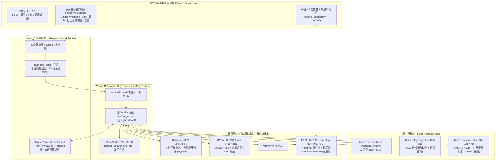
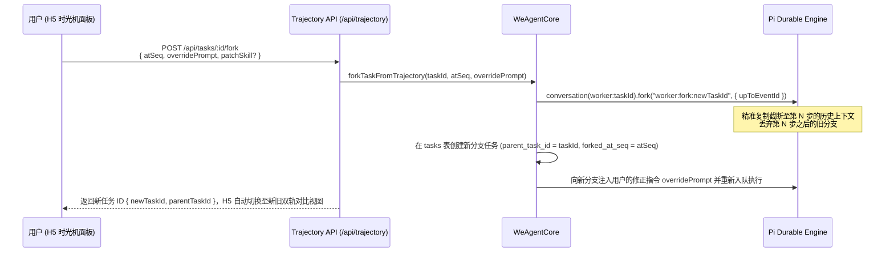

# WeAgent v3.0 技术规格说明书（Technical Specification）

> **版本状态**：v3.0（全栈个人数字分身版：Computer Use 视觉桌面 + 主动感知 + 本地 Hybrid RAG + 多模型成本熔断 + Sub-Worker 分治 + 技能夜间巡检 + **H5 轨迹时光机**）  
> **前置基线**：完全兼容并继承 [SPEC.md](file:///Users/qiu/ai-agents-learning-hub/weagent/SPEC.md)（v0.4 核心基座）与 [SPEC-v2.md](file:///Users/qiu/ai-agents-learning-hub/weagent/SPEC-v2.md)（Hermes 技能沉淀、渐进式放权、早晚报 Digest、Pi Code Mode、Playwright 扫码协助）。  
> **核心目标**：补齐「原生桌面视觉控制 → 主动事件感知 → 私域文档检索 → 成本与多模型治理 → 子代理并行分治 → 技能优胜劣汰 → **H5 全链路轨迹回放与任意节点分叉重跑**」的完整工程闭环。

---

## 1. 全景演进架构（v3.0）



---

## 2. 阶段一：Computer Use 视觉桌面引擎与种子技能包

### 2.1 三层执行梯度路由规范（Tiered Execution Policy）

Worker 系统提示词与工具描述强制灌输以下**成本与速度优先的降级准则**：

| 梯度 | 执行引擎 | 典型延迟 | Token 消耗 | 适用场景与切换条件 |
| :--- | :--- | :--- | :--- | :--- |
| **Tier 1（首选）** | `execute_code`（Pi Code Mode）/ CLI / REST API | `10~200ms` | 极低 | 数据处理、本地文件读写、有公开 API 或 CLI 的服务 |
| **Tier 2（次选）** | `browser_*`（Playwright 持久化 Context） | `0.5~2s` | 中 | 标准 Web 后台、SaaS 页面，能通过 DOM Selector / Role 稳定定位元素 |
| **Tier 3（兜底）** | `computer_*`（Computer Use 视觉键鼠） | `2~5s/步` | 高（含截图） | ① macOS/Linux 原生桌面客户端（企微 PC 端、WPS、内网客户端）；② Canvas/WebGL 页面；③ Playwright 连续 2 次因 Shadow DOM 或反爬无法定位的网页 |

### 2.2 Computer Use 双模驱动抽象：SoM 数字角标 + 多制式坐标归一化（`src/engine/env/computer-env.ts`）

融合开源 `Agent-S`（辅助功能树 + 视觉）与 `OmniParser`（Set-of-Mark 数字打标）思想，纯 TypeScript 实现，**零 Python/CUDA 依赖**，直接对接用户现有 **Command Code / Goat 订阅接口** 与 **Qwen Flash (`qwen-vl` / `qwen-flash`)**。

#### 1. 双后端驱动与 SoM（Set-of-Mark）控件树接口 `ComputerDriver`
```ts
export type ScreenSize = {
  physicalWidth: number;   // 物理像素宽（如 Retina 2880）
  physicalHeight: number;  // 物理像素高（如 Retina 1800）
  logicalWidth: number;    // 归一化逻辑宽（默认 1280）
  logicalHeight: number;   // 归一化逻辑高（默认 800）
};

export type UiMarkElement = {
  markId: number;          // 画面上标注的序号 (#1, #2, ...)
  role: string;            // 如 "AXButton", "AXTextField", "button"
  title: string;           // 控件文本/无障碍标签（如 "提交报销", "导出 CSV"）
  bounds: { x: number; y: number; width: number; height: number }; // 逻辑空间 (1280x800) 矩形
  centerX: number;         // 逻辑空间中心点 X
  centerY: number;         // 逻辑空间中心点 Y
};

export interface ComputerDriver {
  readonly kind: "macos-native" | "xvfb-docker" | "mock";
  getScreenSize(): Promise<ScreenSize>;
  /** 截取桌面并可选提取当前活动窗口的可交互控件列表（用于绘制 [#1] [#2] SoM 数字红框）。 */
  screenshot(opts?: { withSoM?: boolean }): Promise<{
    pngBuffer: Buffer;
    annotatedPngBuffer?: Buffer;
    size: ScreenSize;
    marks: UiMarkElement[];
  }>;
  click(x: number, y: number, button?: "left" | "right" | "double"): Promise<void>;
  move(x: number, y: number): Promise<void>;
  drag(fromX: number, fromY: number, toX: number, toY: number): Promise<void>;
  type(text: string): Promise<void>;
  key(combo: string): Promise<void>; // 如 "Command+C", "Return", "Escape"
  scroll(x: number, y: number, deltaX: number, deltaY: number): Promise<void>;
  getRemoteTakeoverUrl?(sessionToken: string): string | undefined; // noVNC Web URL
}
```

#### 2. 双模定位机制：优先点 `mark_id`（零像素误差），兜底点多制式坐标 `(x, y)`
1. **模式 A：Set-of-Mark (`mark_id`) 精准点击（首选，100% 零漂移）**
   - 在 macOS 宿主上，`screenshot({ withSoM: true })` 通过轻量 JXA / `System Events` 读取前台窗口可交互控件（按钮、输入框、菜单项）的真实 `position` 与 `size`，在截图上直接合成 **`[#1 确认]`、`[#2 取消]`** 数字角标，并把控件清单随文本一并返回给模型。
   - 无论是 **Command Code / Goat 订阅模型** 还是极速 **Qwen Flash**，只需传入 `mark_id: 1`，驱动层直接取 `marks[1].centerX / centerY` 点击，彻底消除视觉坐标估算误差。
2. **模式 B：自适应多制式坐标归一化（Canvas / 自绘界面兜底）**
   - 当目标位于 Canvas 或无辅助功能树的自绘窗口时，模型直接传入 `(x, y)`，`normalizePointToLogical()` 自动识别三种主流坐标制式并统一换算到物理像素：
     - **千分比坐标 `[0, 1000]`（Qwen Flash / Qwen-VL / UI-TARS 默认）**：当指定 `coord_space: "1000"` 时按 `x / 1000 * width` 换算；
     - **归一化浮点比例 `[0.0, 1.0]`**：当 `0 < x <= 1 && 0 < y <= 1` 时自动按比例换算；
     - **逻辑像素坐标 `1280 × 800`（Claude Computer Use 默认）**：按 `x / 1280 * physicalWidth` 换算。

### 2.3 红圈十字准星截图审批（Crosshair Visual Approval）

Computer Use 一旦点错“提交打款 / 群发全员 / 删除库”后果严重，因此将草稿审批机制延伸到视觉坐标级：

1. **工具契约**：`computer_action`
   ```ts
   {
     action: "screenshot" | "click" | "double_click" | "right_click" | "move" | "drag" | "type" | "key" | "scroll" | "wait",
     mark_id?: number,           // [首选] SoM 数字标签 ID (#1, #2...)
     x?: number,                 // [兜底] 横坐标
     y?: number,                 // [兜底] 纵坐标
     coord_space?: "logical" | "1000" | "normalized",
     to_x?: number,
     to_y?: number,
     text?: string,
     key?: string,
     scroll_dy?: number,
     risk_level?: "read_only" | "normal_input" | "high_risk_commit",
     intent_summary?: string     // 如 "点击 [#3 确认报销提交] 按钮"
   }
   ```
2. **红圈准星合成器（`drawCrosshairOverlay`）**：
   - 当 `risk_level === "high_risk_commit"`，或者所点的 `mark_id` 标题 / `intent_summary` 命中高危关键词（`提交|发送|删除|支付|转账|确认|群发|发布|Submit|Delete|Pay|Send`）时：
   - **严禁直接执行物理点击**！系统自动在最新截图的目标 `(x, y)` 处合成一个**醒目红圈 + 十字准星高亮层**，保存至 `/data/trajectories/<task_id>/frames/approval_<id>.png`。
   - 自动创建一条 `action_type = "computer.click"` 的 `pending_approvals` 记录，将带红圈准星的预览图与审批卡推送到用户企微/飞书，并令当前工具轮通过 `control: { terminate: true }` 零消耗停机。
   - 用户在手机上看图确认红圈位置无误、回复 `1` 后，`ActionExecutor` 直接执行物理点击并唤醒 Worker。
3. **点击后自动附带新画面与局部校验（State-Action-State 省一轮 RTT）**：
   - 非高危的普通点击/输入执行后，自动等待 `300ms` 抓取最新截图与更新后的 SoM 控件列表，直接随本次 `computer_action` 工具返回值一并返回，省去模型再单独调一次 `screenshot` 的额外往返延迟。

### 2.4 视觉死循环检测与手机 `noVNC` 远程接管

- **感知哈希（pHash）连续无变化熔断**：每次执行 `click / type / key` 前后计算截图的 `8×8` 灰度均值哈希（aHash）。若连续 **3 步**操作后屏幕汉明距离 `<= 2`（画面毫无变化，常见于弹窗遮挡、焦点丢失或滑块验证码）：
- 自动阻断第 4 次盲点，生成 10 分钟有效期的签名 Token，构造 `/computer-assist/:token`（内嵌 `noVNC` WebSocket 代理或实时画布点击转发页），引导 Worker 调用 `worker_report(status="blocked")` 推送手机接管链接。

### 2.5 开箱即用办公种子技能包（Seed Skills Bootstrapper，`src/app/seed-skills.ts`）

解决冷启动时 `/data/skills/` 为空的问题：
- 服务启动时检查 `/data/skills/.seed_manifest.json`。
- 幂等写入 4 个高质量种子技能（若用户已修改或归档同名技能，绝不覆盖）：
  1. `office/weekly-report`：`Use when summarizing weekly or daily work progress, commits, or completed tasks into a structured report.`（附 `templates/weekly.md`）
  2. `office/meeting-minutes`：`Use when converting voice transcripts, chat logs, or raw meeting notes into structured minutes and action items.`
  3. `research/web-briefing`：`Use when researching competitors, products, or technical topics across multiple web sources into a comparison table.`
  4. `devops/pr-review`：`Use when reviewing git diffs, pull requests, or code patches for bugs, security risks, and style issues.`

---

## 3. 阶段二：多源主动感知网关、本地混合知识库与多模型成本治理

### 3.1 多源主动感知网关（Proactive Sensors Gateway，`src/app/sensors.ts`）

将外部世界的主动变化转化为标准入站事件：

```ts
export type SensorEvent = {
  sensorId: string;           // 如 "github-webhook" | "imap-vip" | "calendar-prep"
  externalEventId: string;    // 幂等去重 ID
  sourceTitle: string;        // 如 "[GitHub] PR #42 CI 失败"
  summary: string;            // 结构化事件摘要
  payloadJson: string;        // 原始详情 JSON
  suggestedUrgency: "immediate" | "digest";
  occurredAt: number;
};
```

1. **入站 Webhook 端点**：`POST /webhooks/sensor/:sensorId`（支持 HMAC-SHA256 签名校验）。
2. **内置周期传感器（挂载在 Pi Durable TaskEngine）**：
   - `sensor.calendar-prep`：每 5 分钟检查即将开始（15 分钟内）的日程，自动触发 Worker 检索参会人历史邮件/聊天记录与相关文档，生成《会前 1 页纸速览卡》推至企微。
   - `sensor.github-ci` / `sensor.imap-vip`：拉取高优外部变更。
3. **分流规则**：
   - `suggestedUrgency === "digest"` 的低优通知直接写入早晚报摘要池，**不唤醒 Router**（零 Token 消耗）；
   - `suggestedUrgency === "immediate"` 的事件写入 `triggers` 表并唤醒 Router 分诊。

### 3.2 个人本地混合知识库（Local Hybrid RAG，`src/app/knowledge.ts`）

Mem0 负责存“一句话偏好”，`KnowledgeBase` 负责存用户的**长文档、PDF、表格与本地笔记库**：

#### 1. 存储与索引架构（纯 SQLite 单文件闭环，零外部向量库依赖）
- **文档表 `kb_documents`**：记录 `id, source_path, title, sha256, mime_type, chunk_count, indexed_at`。
- **切片表 `kb_chunks`**：按 Markdown 标题树与段落边界智能切分（目标每片 `400~800` 字符，重叠 `80` 字符），保存 `id, doc_id, chunk_index, heading_path, content, embedding_blob (Float32Array)`。
- **全文索引虚拟表 `kb_chunks_fts`**：基于 SQLite `FTS5`（`tokenize='trigram'`，原生支持中英文子串与关键词精准匹配）。

#### 2. RRF（Reciprocal Rank Fusion）混合检索算法
查询 `kb_search(query, top_k=5)` 时：
1. **路 A（BM25 关键词检索）**：通过 `kb_chunks_fts` 查出前 20 条候选，排序得排名 $r_{\text{fts}}(d)$（对专有名词、接口名、单号极准）。
2. **路 B（语义向量检索）**：若配置了 Embedding API（否则优雅退化为纯 FTS5 + 字符 N-gram 重排），计算查询向量与候选切片的余弦相似度，得排名 $r_{\text{vec}}(d)$。
3. **RRF 融合打分**：
   $$\text{Score}_{\text{RRF}}(d) = \frac{1}{60 + r_{\text{fts}}(d)} + \frac{1}{60 + r_{\text{vec}}(d)}$$
4. 返回前 `top_k` 条切片，附带精确的文档名、章节路径（`heading_path`）与 `chunk_id`。

#### 3. 挂载给 Worker 的工具（`src/engine/extensions/knowledge.ts`）
- `kb_search({ query, top_k })`：混合检索个人知识库切片。
- `kb_read_doc({ doc_id, start_chunk, end_chunk })`：按需展开某个文档相邻切片的完整上下文。
- `kb_ingest_file({ file_path, title })`：将企微收到的文件或本地文件入库索引。

### 3.3 多模型分级路由与每日成本熔断（`src/engine/model-router.ts`）

#### 1. 五类角色分级路由表
```ts
export type ModelRole =
  | "router"            // 入站分诊：要求首字 < 500ms、便宜（如 deepseek-chat / haiku / flash）
  | "worker_default"    // 常规执行：高性价比主力模型
  | "worker_reasoning"  // 复杂规划/代码审查：强推理模型（如 deepseek-reasoner / claude-sonnet）
  | "vision_cua"        // Computer Use 视觉定位：多模态 VLM
  | "curator";          // 后台技能复盘：低成本后台模型
```

#### 2. 成本账本与熔断器（Cost Guard）
- 每次模型调用结束后，钩子自动将 `conversation_id, task_id, role, model_id, prompt_tokens, completion_tokens, estimated_cost_usd` 写入 `token_usage_ledger` 表。
- **双道熔断防跑飞**：
  - **单任务上限（`MAX_TASK_COST_USD`，默认 `$1.50`）**：单个任务累计消耗超限时，暂停当前 Worker 并通过 `worker_report(status="blocked")` 询问用户是否继续追加预算。
  - **全天硬上限（`DAILY_COST_LIMIT_USD`，默认 `$8.00`）**：当日累计超限时，自动暂停所有后台复盘（Curator）与非紧急主动传感器，仅保留用户直接下达的 `direct_command`。

---

## 4. 阶段三：Sub-Worker 并行分治与技能健康度巡检

### 4.1 Sub-Worker 并行分治（Map-Reduce Subagents，`src/engine/extensions/subworker.ts`）

防止多目标调研或批量文件分析撑爆主 Worker 上下文：

- **工具契约**：`spawn_subworkers`
  ```ts
  {
    subtasks: Array<{
      id: string,
      title: string,
      prompt: string,
      tools_profile: "read_only_research" | "kb_and_code" // 严禁挂载 propose_action 等外部副作用工具
    }>, // 单次最多 5 个子任务
    concurrency?: number // 默认 3
  }
  ```
- **执行隔离**：
  - 每个子任务创建一个独立的 Pi Durable 会话 `subworker:${taskId}:${subId}:${ts}`，最大执行轮数硬限制为 `6` 轮。
  - 子任务只允许调用只读检索、网页读取、知识库查询或沙箱计算，最后必须输出 `<= 600` 字的结构化结论。
  - 主 Worker 的上下文里**只保留汇总后的精炼结论**，所有中间网页原文与工具噪音全部留在子会话 Journal 中（可在 H5 时光机里点击展开查看）。

### 4.2 技能健康度遥测与夜间巡检（`src/app/skill-hygiene.ts`）

让 `~/.weagent/skills/` 具备自我新陈代谢能力：

1. **遥测采集（`skill_telemetry` 表）**：
   - 当 Worker 在任务中调用了 `skill_view(name)`，系统自动将该技能与当前 `task_id` 绑定。
   - 当该任务后续产生草稿审批结果时，自动更新该技能的统计指标：
     - `views_count`（总调用次数）
     - `first_try_approve_count`（草稿一次通过次数）
     - `edit_or_reject_count`（被用户修改或拒绝次数）
     - `last_used_at`（最后使用时间戳）
2. **夜间大扫除任务（`weagent.skill-hygiene-cron`，每周日 03:00）**：
   - **低分技能诊治**：筛选 `views_count >= 3` 且 `edit_or_reject_count / views_count > 0.4` 的技能，拉取最近 5 条用户的 `user_edit_feedback`，唤醒后台 Curator 自动 `patch` 修正该 `SKILL.md` 的踩坑章节。
   - **僵尸技能归档**：筛选超过 60 天未命中（`last_used_at < now - 60d`）且 `pinned === false` 的技能，自动归档至 `.archive/` 并记录账本。
3. **外部技能安全安装（`/skills install <url>`）**：
   - 支持从 GitHub Raw / Gist 拉取开源 `SKILL.md`，先在内存中执行 `scanContent(content, "SKILL.md")`（`skills_guard` 静态扫描），若判定 `dangerous` 直接拦截并告警；若 `clean` 则通过 `SkillStore.manage([{ action: "create", ... }])` 原子入库。

---

## 5. 阶段四：H5 轨迹时光机（Trajectory Time-Machine & Fork Replay）

这是 WeAgent 可解释性、可调试性与高阶操控的核心交互界面。

### 5.1 轨迹数据模型（统一融合 Pi Journal + 业务状态 + 视觉帧）

每一次任务运行的所有细节都沉淀为一条由 `TrajectoryEvent` 构成的有序时间轴：

```ts
export type TrajectoryNodeKind =
  | "trigger_inbound"     // 入站事件/传感器触发
  | "router_decision"     // Router 分诊结果（accept/drop/observe + note）
  | "llm_turn"            // 模型推理轮（含耗时、Token、成本、思考摘要）
  | "tool_call"           // 工具调用（含入参、返回值、是否出错、截图帧 URL）
  | "subworker_group"     // Sub-Worker 并行分治节点（可展开子时间轴）
  | "approval_gate"       // 草稿/红圈准星审批卡点（含用户决策与修改反馈）
  | "worker_report"       // Worker 阶段性汇报或 handback
  | "skill_crystallized"; // 后台复盘沉淀/更新了哪个 SKILL.md

export type TrajectoryNode = {
  seq: number;                    // 递增序号 (1..N)
  nodeId: string;                 // 唯一节点 ID
  piEventId?: number;             // 对应 Pi Durable journal 的 event_id（供 fork 使用）
  conversationId: string;         // 所属会话 (router:main / worker:12 / subworker:12:a)
  kind: TrajectoryNodeKind;
  timestamp: number;
  durationMs?: number;
  title: string;                  // 一句话人类可读标题
  detailJson: Record<string, unknown>;
  screenshotUrl?: string;         // 若为 browser/computer 工具，附带当步截图或红圈图
  costUsd?: number;
  tokens?: { prompt: number; completion: number };
};
```

### 5.2 核心能力：任意历史节点分叉重跑（Fork & Replay from Step $N$）

依托 `@earendil-works/pi-durable` 的日志化溯源能力，用户在 H5 时光机时间轴上点选任意一个 `llm_turn` 或 `tool_call` 节点（序号 `seq`），可执行两种“改变历史”操作：



1. **指令覆写分叉（Prompt Override Fork）**：
   - 场景：Worker 在第 5 步理解错了意图去查了错误的表。
   - 操作：用户在时光机点开第 4 步，输入修正提示 `"不要查旧表 orders_v1，改查 orders_v2"`，点击 **「从此处分叉重跑」**。
   - 实现：系统从第 4 步对应的快照克隆出新任务 `#15 (forked from #12 @ step 4)`，省去前 4 步重复执行的时间与 Token，直接沿着正确方向往下走。
2. **修完技能立即重放验证（Patch Skill & Replay）**：
   - 场景：用户在时光机看到 Worker 因为某个 `SKILL.md` 写得不清楚而踩坑。
   - 操作：用户在 H5 面板直接点开该技能在线微调一行规则，然后点 **「应用新技能并从第 N 步重跑」**，当场验证修改后的 `SKILL.md` 能否一把跑通。

### 5.3 H5 轨迹时光机 API 与前端视图规范（`src/http/trajectory-api.ts`）

| HTTP 路由 | 方法 | 功能说明 |
| :--- | :--- | :--- |
| `/api/tasks/:id/trajectory` | `GET` | 返回任务 `#id` 的完整 `TrajectoryNode[]` 时间轴、总耗时、总 Token 与总费用 |
| `/api/tasks/:id/frames/:frameId` | `GET` | 读取该任务执行过程中的 Playwright / Computer Use 历史截图或红圈准星预览图 |
| `/api/tasks/:id/fork` | `POST` | 从指定节点分叉创建新任务并立即调度执行，支持传入 `overrideInstruction` |
| `/api/cost/summary` | `GET` | 返回今日/近 7 天按模型角色（Router/Worker/Vision/Curator）拆分的 Token 与成本账单 |
| `/api/skills/telemetry` | `GET` | 返回所有技能的调用次数、一次通过率、被打回率及最近 `.curator_ledger.jsonl` 变更对比 |
| `/api/kb/docs` | `GET/POST` | 查看已入库的个人知识库文档列表，或在线上传/检索文档切片 |

**H5 面板新增 3 个标签页（在原有待办审批 Tab 旁）**：
1. **🕰️ 轨迹时光机（Time Machine）**：左侧（或顶部折叠）任务流列表，主屏为交互式垂直时间轴 + 顶部**步进播放器滑块（Step Scrubber `1..N`）** + 截图画廊 + **「从这步分叉重跑」** 按钮。
2. **🧠 技能与知识库（Brain & KB）**：展示 `SKILL.md` 健康度排行（一次通过率徽章、一键回滚按钮）+ 本地 Hybrid RAG 知识库搜索框。
3. **📊 成本与传感器（Ops & Cost）**：展示每日预算进度条、各模型消耗占比、主动传感器开关状态。

---

## 6. 数据库 Schema 增量设计（`app.sqlite` v3 新增表）

在 [SPEC-v2.md](file:///Users/qiu/ai-agents-learning-hub/weagent/SPEC-v2.md) 已有 7 张表的基础上，新增以下 6 张表（迁移幂等）：

```sql
-- 1. 任务表扩展字段（支持轨迹分叉溯源）
-- ALTER TABLE tasks ADD COLUMN parent_task_id INTEGER NULL;
-- ALTER TABLE tasks ADD COLUMN forked_at_seq INTEGER NULL;

-- 2. 轨迹事件表（记录业务级时间轴节点与视觉帧关联）
CREATE TABLE IF NOT EXISTS trajectory_events (
  id INTEGER PRIMARY KEY AUTOINCREMENT,
  task_id INTEGER NOT NULL,
  seq INTEGER NOT NULL,
  node_id TEXT NOT NULL,
  pi_event_id INTEGER NULL,
  conversation_id TEXT NOT NULL,
  kind TEXT NOT NULL,
  title TEXT NOT NULL,
  detail_json TEXT NOT NULL DEFAULT '{}',
  screenshot_path TEXT NULL,
  duration_ms INTEGER NULL,
  prompt_tokens INTEGER NOT NULL DEFAULT 0,
  completion_tokens INTEGER NOT NULL DEFAULT 0,
  cost_usd REAL NOT NULL DEFAULT 0,
  created_at INTEGER NOT NULL
);
CREATE INDEX IF NOT EXISTS idx_traj_task_seq ON trajectory_events(task_id, seq);

-- 3. 模型 Token 与成本账本表（ModelRouter & CostGuard）
CREATE TABLE IF NOT EXISTS token_usage_ledger (
  id INTEGER PRIMARY KEY AUTOINCREMENT,
  task_id INTEGER NULL,
  conversation_id TEXT NOT NULL,
  role TEXT NOT NULL, -- router | worker_default | worker_reasoning | vision_cua | curator
  model_id TEXT NOT NULL,
  prompt_tokens INTEGER NOT NULL,
  completion_tokens INTEGER NOT NULL,
  cost_usd REAL NOT NULL,
  created_at INTEGER NOT NULL
);
CREATE INDEX IF NOT EXISTS idx_cost_created ON token_usage_ledger(created_at);

-- 4. 个人知识库文档与切片表（Local Hybrid RAG）
CREATE TABLE IF NOT EXISTS kb_documents (
  id INTEGER PRIMARY KEY AUTOINCREMENT,
  source_path TEXT NOT NULL UNIQUE,
  title TEXT NOT NULL,
  sha256 TEXT NOT NULL,
  mime_type TEXT NOT NULL DEFAULT 'text/markdown',
  chunk_count INTEGER NOT NULL DEFAULT 0,
  indexed_at INTEGER NOT NULL
);

CREATE TABLE IF NOT EXISTS kb_chunks (
  id INTEGER PRIMARY KEY AUTOINCREMENT,
  doc_id INTEGER NOT NULL,
  chunk_index INTEGER NOT NULL,
  heading_path TEXT NOT NULL DEFAULT '',
  content TEXT NOT NULL,
  embedding_json TEXT NULL, -- Float32 数组 JSON（可选）
  created_at INTEGER NOT NULL
);
CREATE INDEX IF NOT EXISTS idx_kb_chunks_doc ON kb_chunks(doc_id, chunk_index);

-- FTS5 全文索引虚拟表（支持中英文 trigram 检索）
CREATE VIRTUAL TABLE IF NOT EXISTS kb_chunks_fts USING fts5(
  content,
  heading_path,
  content='kb_chunks',
  content_rowid='id',
  tokenize='trigram'
);

-- 5. 技能健康度遥测表（Skill Telemetry & Hygiene）
CREATE TABLE IF NOT EXISTS skill_telemetry (
  skill_name TEXT PRIMARY KEY,
  views_count INTEGER NOT NULL DEFAULT 0,
  first_try_approve_count INTEGER NOT NULL DEFAULT 0,
  edit_or_reject_count INTEGER NOT NULL DEFAULT 0,
  last_used_at INTEGER NOT NULL DEFAULT 0,
  last_task_id INTEGER NULL,
  updated_at INTEGER NOT NULL
);

-- 6. 主动传感器事件幂等账本（Proactive Sensors）
CREATE TABLE IF NOT EXISTS sensor_events (
  id INTEGER PRIMARY KEY AUTOINCREMENT,
  sensor_id TEXT NOT NULL,
  external_event_id TEXT NOT NULL,
  title TEXT NOT NULL,
  urgency TEXT NOT NULL,
  trigger_id INTEGER NULL,
  created_at INTEGER NOT NULL,
  UNIQUE(sensor_id, external_event_id)
);
```

---

## 7. 代码模块落盘映射与实施里程碑（Milestones）

```text
weagent/
├── src/
│   ├── app/
│   │   ├── knowledge.ts           # [新增] Local Hybrid RAG (SQLite FTS5 + Embedding + RRF)
│   │   ├── sensors.ts             # [新增] 多源主动感知网关 (Webhook + 日历会前提醒)
│   │   ├── seed-skills.ts         # [新增] 4 个办公种子 SKILL.md 幂等初始化器
│   │   ├── skill-hygiene.ts       # [新增] 技能健康度遥测统计与周度夜间巡检归档
│   │   └── trajectory.ts          # [新增] 轨迹记录器与任意节点分叉重跑编排器
│   ├── engine/
│   │   ├── model-router.ts        # [新增] 五级模型角色路由、Fallback 链与每日成本熔断器
│   │   ├── env/
│   │   │   └── computer-env.ts    # [新增] Computer Use 驱动 (macOS/Xvfb) + 1280x800 归一化 + 红圈准星绘制
│   │   └── extensions/
│   │       ├── computer.ts        # [新增] computer_action 工具 + 连续 3 步 aHash 无变化检测 + 红圈审批
│   │       ├── knowledge.ts       # [新增] kb_search / kb_read_doc / kb_ingest_file 工具
│   │       └── subworker.ts       # [新增] spawn_subworkers 只读并发子代理分治工具
│   └── http/
│       └── trajectory-api.ts      # [新增] H5 轨迹时光机 API + 分叉重跑端点 + 成本/技能健康度看板
└── test/
    ├── computer-use.test.ts       # [新增] 坐标归一化、红圈准星审批停机与 aHash 死循环检测单测
    ├── knowledge-sensors.test.ts  # [新增] FTS5+RRF 混合检索、传感器去重与分级分流单测
    ├── subworker-hygiene.test.ts  # [新增] Sub-Worker 并行汇总、种子技能注入与技能遥测巡检单测
    └── trajectory-fork.test.ts    # [新增] H5 轨迹时光机时间轴组装与任意节点 Fork 重跑端到端测试
```

### 验收标准（Definition of Done）
1. **M9（Computer Use + 种子技能）**：`computer_action` 在 `high_risk_commit` 时自动生成带红圈准星的 PNG 并创建 `pending_approval` 停机；连续 3 次相同截图画面自动触发 `blocked` 接管提示；首次启动自动初始化 4 个种子技能。
2. **M10（Hybrid RAG + 主动传感器 + 成本熔断）**：`kb_search` 支持中英文关键词与语义 RRF 混合检索；外部传感器事件按 `immediate / digest` 精准分流且幂等去重；超过每日/单任务预算阈值时自动触发熔断。
3. **M11（Sub-Worker 分治 + 技能健康度巡检）**：`spawn_subworkers` 可并发运行多个只读子任务并返回精炼摘要；任务审批通过/打回时自动更新 `skill_telemetry` 一次通过率；支持 `/skills install` 静态扫描入库与僵尸技能自动归档。
4. **M12（H5 轨迹时光机 & Fork 重跑）**：`/api/tasks/:id/trajectory` 完整返回每一步模型与工具节点，调用 `POST /api/tasks/:id/fork` 可从指定历史序号 `atSeq` 克隆出子任务并注入新指令完成重跑。
