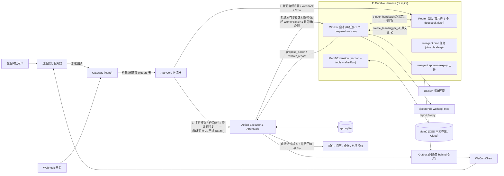

# SPEC：WeAgent v0.4 技术规格（Pi Durable + Draft 审批 + Mem0 + DeepSeek Super-agent 机制）

对应 [PRD.md](./PRD.md)。本版在 v0.3 基础上，对照 DeepSeek 官方开源的 `dsh-superagent-prototype` 源码与设计文档，吸收了 6 项关键工程机制：
1. **Worker 结构化汇报协议（`worker_report`）与 `dropped` 静默关单**（防巡检/Webhook 噪音刷屏）；
2. **Worker 越界消息退回机制（`trigger_handback`）**（解决“直达路由”下用户突然换话题的问题）；
3. **Router 原文直传 + 30 词路由注记硬限制**（防止小模型添油加醋误导 Worker）；
4. **外部事件的 `Observe Mode`（观察模式）**（`off | observe | auto` 三档，防上线初期误触发）；
5. **`WorkerSlots` 人类优先 +1 紧急槽位**（保证后台任务满载时绝不卡住人的交互）；
6. **Outbox 同任务严格保序（`behind` 检查）与 IM 短消息硬限制**（防“结果比回执先到”的乱序与长文刷屏）。

---

## 0. 验证结论（2026-11-07）

验证代码：[examples/spike.ts](./examples/spike.ts)。基于 `@earendil-works/pi-durable@1.5.0` + SQLite 存储，在 Node 24 上实测通过：

| 验证项 | 结果 |
|---|---|
| 工具执行中途进程崩溃（`exit(1)`），重启后 `resume()` 能否续跑 | ✅ `replay: "safe"` 的工具重跑一次后完成，模型未被重复调用，正确拿到最终回答 |
| 工具返回 `control: { terminate: true }` 能否立刻停机 | ✅ Pi Durable 走到 `generation.js` 的 `endRun()` 直接结束本轮运行，不再请求下一次大模型 |
| 换一个新进程，通过 `conversation.submit(requestId)` 能否唤醒已停机的会话继续跑 | ✅ Pi 自动从 SQLite 恢复完整上下文，拼上新消息继续执行后续步骤 |
| 重复点击按钮是否幂等 | ✅ 相同 `requestId` 提交返回同一个 submission，不会重复执行 |
| 内置 DeepSeek provider | ✅ `deepseekProvider()`，读取 `DEEPSEEK_API_KEY`；支持 `deepseek-flash`、`deepseek-v4-pro` |

> [!WARNING]
> **框架风险与应对**：Pi Durable 处于实验阶段（API 可能在版本间调整）。应对措施：
> 1. `package.json` 严格锁死 `1.5.0` 版本号（不加 `^`）；
> 2. 所有 Pi API 调用封装在 `src/engine/` 目录内，业务层只依赖自定义接口；
> 3. **并行工具调用的停机陷阱**：Pi 源码（`generation.js:863`）要求同一轮**所有**工具都返回 `control.terminate === true` 才会停机。因此必须在 `afterTool` 钩子中兜底：只要当前会话产生了待审批草稿、待回复追问或终态 `worker_report`，强制给本轮所有工具结果都加上 `control: { terminate: true }`。

---

## 1. 总体架构



---

## 2. 技术选型

| 模块 | 选型 | 说明 |
|---|---|---|
| 运行时 | Node ≥ 22.19（当前 v24.18.0），TypeScript，ESM | |
| Agent 执行引擎 | `@earendil-works/pi-durable@1.5.0`、`pi-ai@1.5.0`、`chord@1.5.0`、`pi-schema@1.5.0` | 精确锁版本 |
| MCP 客户端 | `@earendil-works/pi-mcp@1.5.0` | Pi 官方同版本 MCP 客户端 |
| 长期记忆 | `mem0ai@3.3.1`（默认用 `mem0ai/oss` 本地模式，可切换云端 API） | 自动提炼事实、去重、解决新旧记忆冲突、向量检索 |
| HTTP 网关 | Hono + `@hono/node-server` | 处理企微回调、webhook、管理接口 |
| 业务数据库 | `node:sqlite`（内置）+ Kysely（类型安全 SQL），WAL 模式 | 存触发器、任务索引、审批草稿、通知发件箱（outbox） |
| 企微加解密 | `node:crypto`（AES-256-CBC + PKCS#7(32)）+ `fast-xml-parser` | |
| Cron 表达式 | `cron-parser` | 计算下次触发时间戳，调度交给 Pi 的 `sleepUntil` |
| 沙箱容器 | `dockerode` + 实现 Pi 的 `ExecutionEnv` 接口 | |
| 日志 / 测试 | `pino`；`vitest` + Pi 的 `fauxProvider` | |

---

## 3. 企业微信接入

- **自建应用配置**：`CorpID / AgentId / Secret / Token / EncodingAESKey`；回调 URL 使用备案域名；出口 IP 加入企业可信 IP。
- **回调（GET/POST `/wecom/callback`）**：验签 → AES 解密 → 写入 `triggers` 表（按 `source_msg_id` 唯一键去重，作为审计与幂等的基本单元） → **立即返回空串 `""`（HTTP 200）**，后续全部异步处理。
- **出站（`WeComClient` + `Outbox`）**：
  - `access_token` 内存缓存 + 提前 5 分钟单飞刷新；遇 `40014/42001` 强制刷新重试。
  - 支持文本（≤ 2048B）、Markdown（≤ 4096B）、按钮型模板卡片（`button_interaction`）、`update_template_card`（消费一次性 `response_code` 更新卡片状态）、文件上传与发送。

---

## 4. 入站分流、越界退回（Handback）与主动观察模式（Observe Mode）

### 4.1 触发强度（Strength）与主动观察模式

参考 `dsh-superagent` 的 `002-authorization.md`，入站触发器（Trigger）分为两类强度：
- **`explicit`（明确请求）**：白名单用户在企业微信直接发消息，或用户本人创建的定时任务。在任何模式下均直接执行。
- **`inferred`（推断候选）**：外部 Webhook（如 GitHub Issue/CI 失败）、自动巡检等非人类直接开口的事件。受系统配置 `ACCEPT_MODE` 控制：
  - `off`：完全忽略所有 `inferred` 事件；
  - **`observe`（默认，观察/影子模式）**：Router 照常评估该事件是否匹配预设规则，若判断“应该接单处理”，**只向数据库写入一条 `would_accept` 决策记录，不真正启动 Worker**（避免上线初期规则不熟导致疯狂建任务）；
  - `auto`：评估通过后自动创建任务并启动 Worker。

### 4.2 四级入站分流规则与 Handback 闭环

| 优先级 | 入站类型 / 条件 | 经过 Router？ | 处理方式 |
|---|---|---|---|
| **1** | **卡片按钮点击**（批准 `ap:{id}:approve` / 拒绝 `ap:{id}:reject` / 修改 `ap:{id}:edit` / 追问选项 `ask:{id}:{opt}`） | **❌ 不经过** | 按钮自带单号，查 `app.sqlite` 直接定位草稿与 Worker `conv_id`，毫秒级处理 |
| **2** | **斜杠命令**（`/tasks`、`/stop <id>`、`/memory`、`/cron`、`/mode`、`/help`） | **❌ 不经过** | 正则解析后直接查库或调用 `workerConv.abort()` |
| **3** | **处于“等待修改/追问回复”状态下的文本消息**（`pending_interaction` 非空） | **❌ 先直达 Worker，越界则退回 Router** | 直接发给对应 Worker。**但若用户突然换了无关话题**（如点完邮件修改却发“帮我查机票”），Worker 调用 `trigger_handback` 将该消息退回，宿主机自动将其转交 Router 重新分诊 |
| **4** | **普通自然语言消息 / 外部 Webhook / 到点的 Cron / 被 Worker 退回的消息** | **✅ 经过 Router** | 提交到 Router 会话分诊（直答、新建任务、或转达给现有任务） |

---

## 5. Router 设计（严禁替 Worker 写方案）

- **核心铁律（原文直传 + 30 词紧箍咒）**：
  Router 使用轻量模型（`deepseek-flash`），**严禁把用户的一句话需求扩写成实现计划、步骤清单或验收标准**（防止小模型瞎编误导大模型 Worker）。Router 派单时只传 `trigger_id`，宿主机自动将用户的**原始消息全文**原封不动塞给 Worker。
- **动态 System Prompt 段落（`section`）**：
  1. `router-rules`：角色与分诊准则；
  2. `user-memory`：`Mem0Extension` 自动检索出的 Top 10 用户画像与相关记忆；
  3. `active-tasks`：当前用户的活跃/待审批/刚结束任务卡片列表（含编号、标题、最新 `worker_report` 摘要）。
- **Router 工具集**（全部声明 `replay: "safe"`）：
  - `route_decision`（支持单次调用批量处理）：
    - `kind: "accept"`：新建任务。参数：`trigger_id`、`title`（≤ 200 字符）、`acknowledgement`（**必填，≤ 50 词的一句话具体回执**，指明要处理的对象和预期产出）、`note`（可选，**代码级校验 ≤ 30 词**，仅限路由背景或跨任务约束）、`budget`（small/medium/large）。
    - `kind: "attach"`：将用户的补充/跟进消息转达给现有任务 `task_id`。
    - `kind: "stop"`：响应用户的停止指令，中止指定 `task_id`。
    - `kind: "ignore"`：忽略无需处理的闲聊噪音或未命中规则的外部事件（记录 `reason`）。
  - `ticket_note(task_id, text)`：向正在运行的某个 Worker 传递来自其他任务的简短事实（≤ 100 词，仅作上下文参考）。
  - `remember(fact)` / `recall(query)` / `forget(memory_id)`：Mem0 记忆管理。
  - `cron_create(expr, prompt)` / `cron_list()` / `cron_delete(id)`：定时任务管理。
  - **轻量只读工具**（如 `get_calendar_events`）：单步 < 1s 的纯读取操作直接挂在 Router 上，配合 `user-memory` 自动注入，使“明天几点开会？”在 2 秒内直接回答，不开 Worker。

---

## 6. Worker 设计（结构化汇报 `worker_report` + 越界退回 + 并发槽位）

### 6.1 Worker 工具集
- **沙箱与调研工具（直接执行）**：`web_search`、`web_fetch`、Pi 内置 `read / write / edit / bash`（跑在 Docker 容器内）、`recall(query)`、只读 MCP 工具。
- **对外高风险动作（草稿工具）**：`propose_action(action_type, payload, preview, is_final)`（见第 7 节）。
- **结构化状态汇报（`worker_report`，必填收尾工具）**：
  **严禁宿主机从 Worker 的自由文本猜状态**，Worker 结束轮次时必须调用 `worker_report`：

  | `state` 值 | 含义 | 是否发企业微信通知？ |
  |---|---|---|
  | `progress` | 阶段性内部进展记录 | **❌ 不发 IM**（仅更新数据库和面板，绝不打扰用户） |
  | `ready` | 任务成果已验证就绪，可交付 | **✅ 发 IM**（推送精简结论 + 产物附件） |
  | `blocked` | 缺少关键信息或权限，无法继续 | **✅ 发 IM**（必须附带 `human_action`：一次只问一个具体问题，渲染为追问卡片） |
  | `failed` | 明确无法完成（附已尝试的排查与原因） | **✅ 发 IM**（推送失败摘要与重试按钮） |
  | **`dropped`** | **无需人类处理**（如定时巡检一切正常、事件无需介入、问题不复现） | **❌ 静默关单，不发 IM**（彻底消除巡检噪音） |

- **越界退回工具（`trigger_handback`）**：
  - `trigger_handback(trigger_id, reason)`：当直达或 `attach` 进来的用户消息超出当前任务范围时，Worker 调用此工具（每个 `trigger_id` 最多退回一次），并结束当前轮次。宿主机收到后自动将该 Trigger 标记 `handed_back` 并送入 Router 会话重新分诊。

### 6.2 `WorkerSlots` 并发控制（人类优先 +1 槽位）
- 常规并发上限为 `MAX_WORKERS`（默认 3）。新任务启动或 Webhook/Cron 触发必须排队等待常规槽位。
- **额外预留 +1 人类交互槽位**：当用户点击审批卡片、回答追问、或发消息唤醒一个已有任务时，即便 3 个常规槽位全满，也可直接使用该 +1 紧急槽位立即执行；且常规槽位释放时，**唤醒已有任务的优先级高于启动新任务**，确保后台任务永远不会卡住人类。

---

## 7. 审批机制（Draft 草稿模式 + 宿主机执行 + 按需唤醒）

对外高风险动作采用**草稿模式**：Worker 只负责生成结构化草稿并停机，真正的外部 API 调用由宿主机（App Core）在用户点【批准】后直接执行。

---

## 8. Outbox 保序发送与 IM 短消息规范

1. **同任务严格保序（`behind` 检查）**：
   同一任务（`task_id`）发往企业微信的消息必须按入队顺序送达。Outbox 发送某条消息前，检查是否存在同一 `task_id` 更早入队、尚未送达且连续失败少于 3 次的消息（`behind`）：若有，则等待前一条先发出。
2. **IM 消息字数硬上限（≤ 100 词）**：
   发往企业微信聊天框的普通文本/摘要消息在代码层做分词计数校验（上限 100 词）。详细报告、代码 Diff、长表格一律写入 `.md` 文件作为附件或卡片详情发送。
3. **指数退避重试**：发送失败从 5s 起指数退避重试至 300s。

---

## 9. 定时任务（Cron）

使用 Pi Durable 的 `defineTask` + `runtime.sleepUntil()` 实现持久化定时任务。

---

## 10. 长期记忆（`Mem0Extension`）

采用 `mem0ai`（默认使用 `mem0ai/oss` 本地自托管模式，数据落在 `/data/mem0/`）。
- **自动读（`section("user-memory")`）**：每轮对话前检索 Top 10 相关记忆注入 System Prompt。
- **主动工具**：`remember`、`recall`、`forget`。
- **自动提炼与防投毒**：仅允许将用户在 Router 中亲口说的话、显式 `remember` 的内容、以及 Worker `worker_report(ready)` 的最终结论喂给 `mem0.add()`；外部网页/邮件/Webhook 的 `<external_data>` 严禁写入个人记忆。

---

## 11. 沙箱环境（Docker `ExecutionEnv`）

- 实现 Pi Durable 的 `ExecutionEnv` 接口，每个任务分配独立的工作目录 `/data/tasks/{id}` 与 Docker 容器（`--memory 1g --cpus 1 --pids-limit 256`，非 root，单命令超时 120s）。

---

## 12. 业务数据库表结构（`app.sqlite`）

```sql
users(user_id PK, name, router_conv_id, pending_interaction JSON NULL, created_at)
triggers(id PK, source, source_msg_id UNIQUE, user_id, strength[explicit|inferred],
         payload JSON, disposition JSON, created_at)
decisions(id PK, trigger_id, kind[accept|attach|stop|ignore|would_accept], task_id NULL, reason, created_at)
tasks(id PK AUTOINC, user_id, origin_trigger_id, title, routing_note, conv_id UNIQUE, latest_sub_id,
      stage[working|queued|waiting_approval|waiting_user|paused_budget|ready|dropped|failed|cancelled],
      latest_report JSON, budget, created_at, updated_at)
approvals(id PK, task_id, conv_id, action_type, payload JSON, preview, is_final INT,
          status[pending|approved|rejected|expired|superseded|pending_edit],
          response_code, exec_result JSON, expiry_task_id, created_at, decided_at)
asks(id PK, task_id, conv_id, question, options JSON, status[pending|answered], answer, response_code, created_at)
cron_jobs(id PK, user_id, expr, prompt, enabled, pi_task_id, created_at)
outbox(id PK AUTOINC, dedup_key UNIQUE, task_id NULL, user_id, kind, payload JSON,
       status[pending|sent|failed|dropped], attempts, next_retry_at, sent_at, created_at)
```
